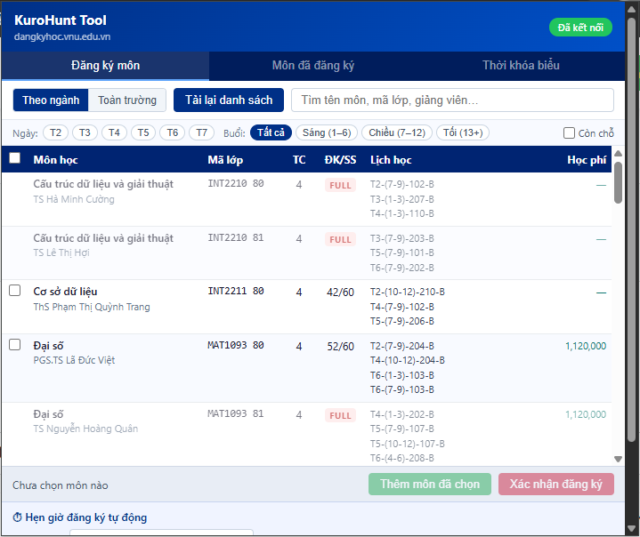
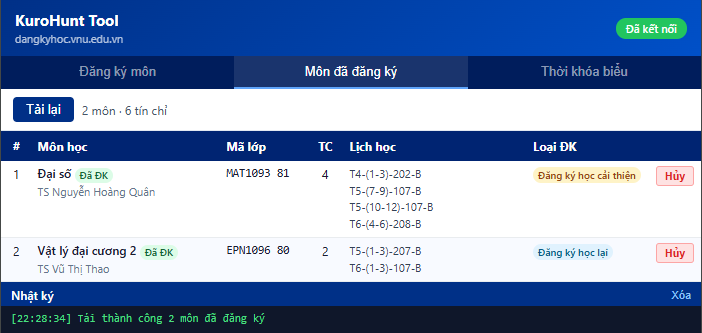
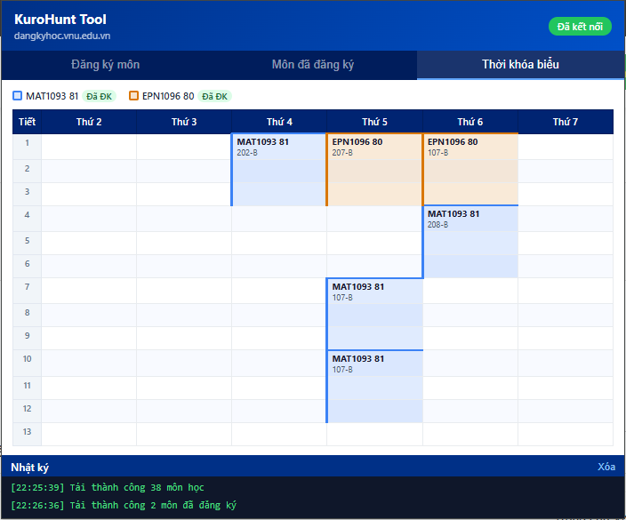

# KuroHunt Tool

A Chrome Extension that automates course registration at **dangkyhoc.vnu.edu.vn**.

---

## 🛠️ Features

| Feature | Description |
|---|---|
| Course list | Load courses by department or university-wide |
| Select & register | Pick multiple courses, auto-detect schedule conflicts |
| Scheduler + Race mode | Register all selected courses in parallel at a set time, with auto-retry |
| Registered courses | View status, cancel courses directly |
| Timetable | Visual grid Mon–Sat × Period 1–13, highlights conflicts |
| Advanced filter | Filter by day, time of day, or available spots only |

---

## 📦 Installation

1. Download or clone this repo
2. Chrome → `chrome://extensions` → enable **Developer mode**
3. Click **Load unpacked** → select the `KuroHunt_Tool` folder

---

## 🚀 Usage

> The site uses Cloudflare CAPTCHA, so **login must be done manually**.
> After logging in, the extension handles everything else automatically.

1. Log in manually at [dangkyhoc.vnu.edu.vn](https://dangkyhoc.vnu.edu.vn)
2. Open the extension → load the course list → select courses
3. Register immediately or set a timer for the extension to register automatically

---

## ⚡ Special Feature

While everyone else is waiting for the registration window to open — **KuroHunt has already secured your spot.**

This is not just automation. It's an unfair advantage. Combined with the scheduler and race mode, you are always ahead of the competition.

---

## 📸 Demo

**Course registration**

**Registered courses**

**Timetable**

---

## 💬 Availability

This repository is a **preview only** — the source code is not publicly available.

The tool is available for purchase. If you are interested, feel free to reach out.

---

> This tool is provided as-is for personal use. The author assumes no responsibility for any consequences resulting from its use.
